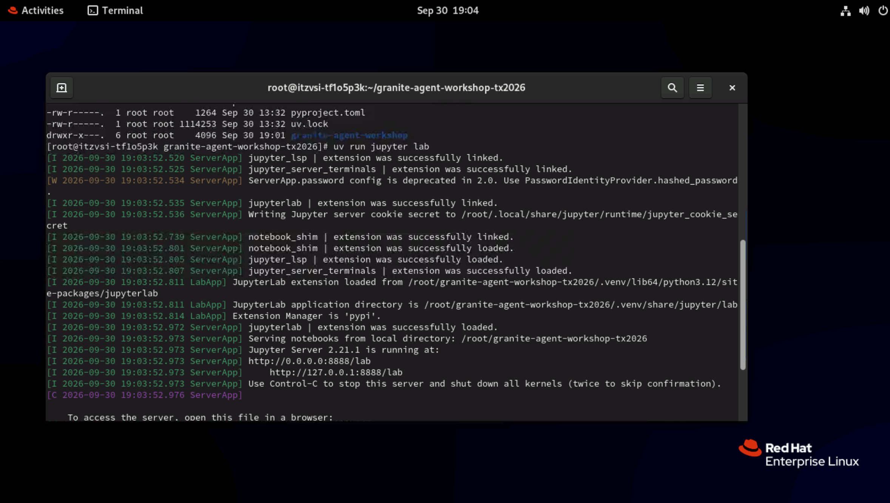
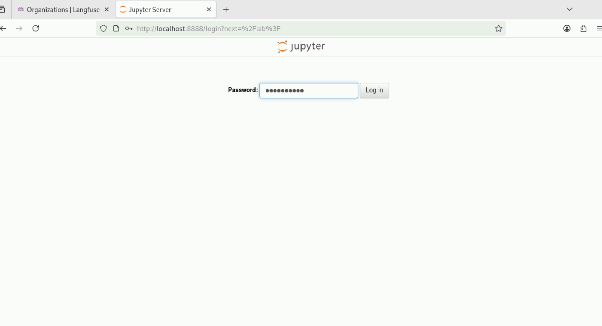

# Getting Started

In this step you open JupyterLab and find the workshop notebooks.

On the lab workstation, everything is set up for you: the workshop repository is already cloned and JupyterLab is already running. If you're using your own computer, follow the **Your own computer** tabs to clone the repository and start JupyterLab yourself.

## The workshop repository

/// tab | Lab workstation

The repository is already cloned on the `tx-26-lab` branch in `/root/granite-agent-workshop-tx2026/granite-agent-workshop`. There's nothing to do here.

/// note | Repository missing?
If the `granite-agent-workshop` folder isn't there, open a terminal and clone it:

```shell
cd /root/granite-agent-workshop-tx2026
git clone --branch tx-26-lab https://github.com/jslecointre/granite-agent-workshop.git
```

///

///

/// tab | Your own computer

It is recommended that you have:

- Knowledge of [Git](https://git-scm.com/) and [Python](https://www.python.org/)
- Git
- Python 3.12 or 3.13

If not, use [Google Colab](https://colab.research.google.com) instead.

/// tip | Installing Python

If you don't have Python installed, or the installed version is not one of the versions supported by this workshop, you should consider installing and using the [`uv` tool](https://docs.astral.sh/uv/getting-started/installation/) to assist in installing the proper Python version.
`uv` works on macOS, Linux, and Windows.
Once `uv` is installed, you can install Python 3.13 with

```shell
uv python install --default 3.13
```

You can then update the shell configurations files to add the Python commands to the PATH.

```shell
uv python update-shell
```

///

1. Clone the workshop repository on the `tx-26-lab` branch and `cd` into it:

    ```shell
    git clone --branch tx-26-lab https://github.com/jslecointre/granite-agent-workshop.git
    cd granite-agent-workshop
    ```

///

## Open JupyterLab

/// tab | Lab workstation

1. JupyterLab is already running. In the browser, open <http://localhost:8888>.

    /// note | Page doesn't load?
    If JupyterLab isn't responding, open a terminal and start it from the workshop directory:

    ```shell
    cd /root/granite-agent-workshop-tx2026
    uv run jupyter lab
    ```

    Wait for the `Jupyter Server ... is running at` message, then reload <http://localhost:8888>. Leave this terminal open: closing it stops JupyterLab.

    

    ///

1. On the login page, enter the password `jupyterlab` and click **Log in**.

    

1. In the JupyterLab file browser, open `granite-agent-workshop/notebooks`. The notebooks are numbered in the order you will run them.

1. Open the first notebook and run its first cell to confirm the kernel starts. If it fails, raise your hand now rather than during the first lab.

///

/// tab | Your own computer

From the `granite-agent-workshop` folder you cloned above:

/// tab | uv (recommended)

1. Create the virtual environment and install the workshop's locked dependencies, JupyterLab included:

    ```shell
    uv sync
    ```

    This creates a `.venv` folder from `pyproject.toml` and `uv.lock`, so you get the same package versions as the lab workstation.

1. Start JupyterLab and open the `notebooks` folder:

    ```shell
    uv run jupyter lab
    ```

///

/// tab | venv

1. Create a [virtual environment](https://docs.python.org/3/library/venv.html) and activate it:

    ```shell
    python3 -m venv --upgrade-deps --clear venv
    source venv/bin/activate
    ```

1. Install JupyterLab in the virtual environment:

    ```shell
    python3 -m pip install --require-virtualenv jupyterlab ipywidgets
    ```

    Each notebook installs its own dependencies in its first cell. For more information, see the [Jupyter installation instructions](https://jupyter.org/install).

1. Start JupyterLab (in the active virtual environment) and open the `notebooks` folder:

    ```shell
    jupyter lab
    ```

///

///

Next: [1. Access the Model](../part-01-access-the-model/README.md).
