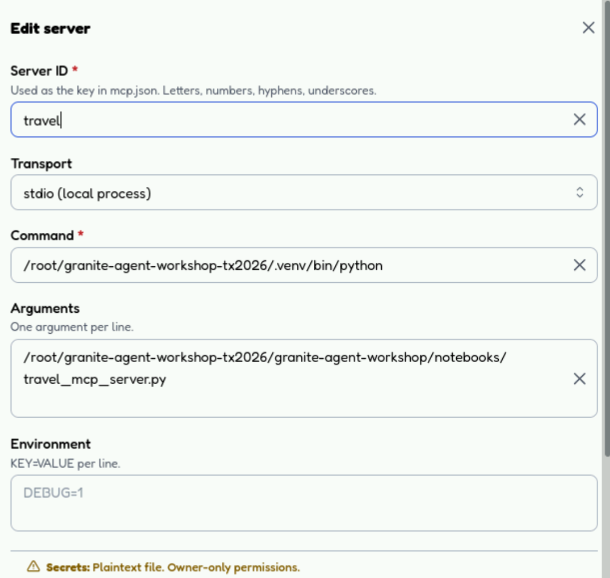
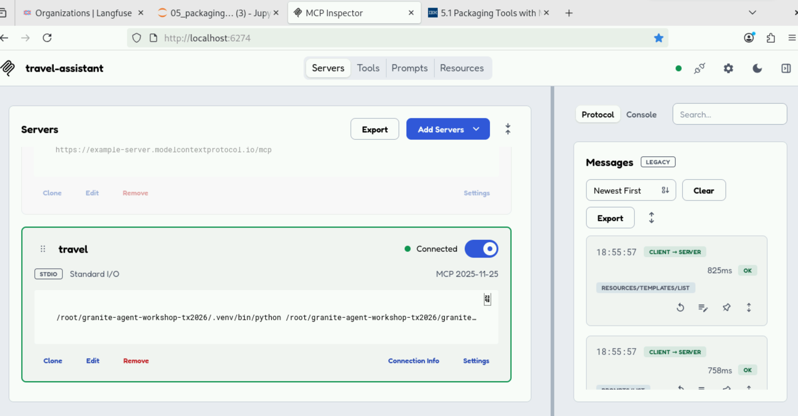
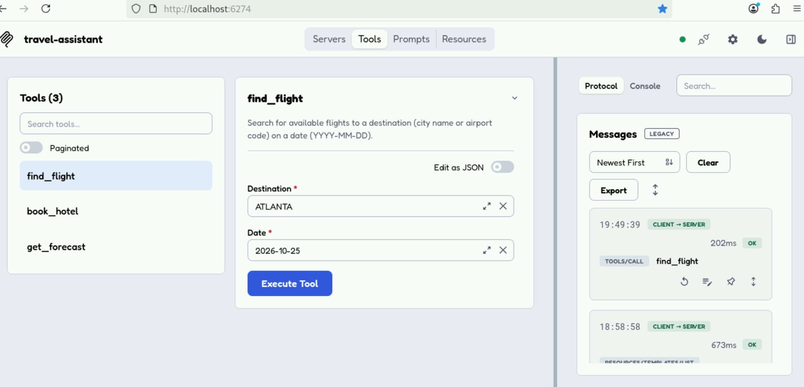
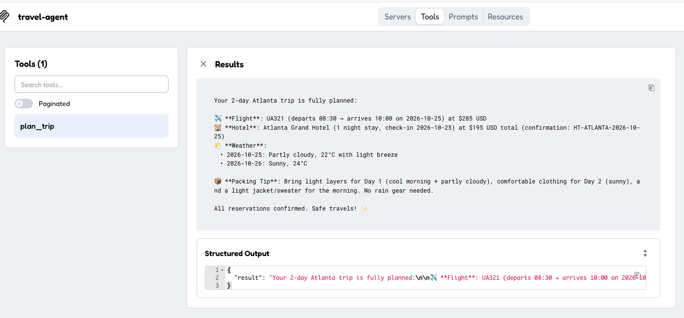

# Packaging Tools with MCP

The tools in [Building Agents](../part-02-building-agents/README.md) are Python functions inside the agent's process: no other agent, framework or team can use them. The [Model Context Protocol (MCP)](https://modelcontextprotocol.io) moves tools into a separate server with a standard interface, so any MCP client can discover and call them.

In this lab you package three travel tools (`find_flight`, `book_hotel`, `get_forecast`) as an MCP server, test them by hand, then give them to a Granite agent that plans a trip to Atlanta.

## What you will learn

| Step | You do | Takeaway |
| :--- | :--- | :--- |
| 1 | Read how MCP works | A client and a server exchange JSON-RPC: `initialize` → `tools/list` → `tools/call`. When something breaks, find which of the three failed. |
| 2 | Build the server with [FastMCP](https://github.com/modelcontextprotocol/python-sdk) | One decorator turns a typed Python function into a tool. The docstring becomes the description the model reads, so write it for the model. |
| 2.1 | Call the tools in [MCP Inspector](https://github.com/modelcontextprotocol/inspector) | Test the server with no model involved. If a tool misbehaves here, the bug is in the server, not in the prompt. |
| 3 | Connect a LangGraph agent with [`langchain-mcp-adapters`](https://reference.langchain.com/python/langchain-mcp-adapters) | `MultiServerMCPClient` turns MCP tools into LangChain tools: the agent code contains no protocol code. |
| 4 | Package the whole agent as an MCP server | Wrap the agent in a single `plan_trip` tool. The caller needs only an MCP client: the model, the agent loop and the three tools all run inside the server. |

## Prerequisites

This lab is a [Jupyter notebook](https://jupyter.org/). At the workshop, your workstation is already set up: there is nothing to install. To run it on your own machine or in Colab, complete [Getting Started](../getting-started/README.md) first.

Step 2.1 also needs [Node](https://nodejs.org/) 22 or later, to run MCP Inspector with `npx`. It is optional: the rest of the notebook runs without it.

## Lab

[]({{ config.repo_url }}/blob/{{ extra.repo_branch }}/{{ notebook }}){:target="_blank"}
[]({{ extra.colab_url }}/blob/{{ extra.repo_branch }}/{{ notebook }}){:target="_blank"}

Open the notebook in the way that matches where you are working:

/// tab | Lab workstation

In the JupyterLab file browser, open `granite-agent-workshop/{{ notebook }}`. If JupyterLab isn't running yet, see [Getting Started](../getting-started/README.md#open-jupyterlab).

///

/// tab | Colab

Click **Open in Colab** above. The first code cell installs everything the notebook needs. Colab needs a Replicate API token: see [Setting up Replicate](../part-01-access-the-model/README.md#setting-up-replicate).

MCP Inspector (step 2.1) needs a local browser and terminal, so skip it in Colab.

///

/// tab | Your own machine

From the `granite-agent-workshop` folder you cloned in [Getting Started](../getting-started/README.md), with its virtual environment active, run:

```shell
jupyter notebook {{ notebook }}
```

///

## MCP Inspector

[MCP Inspector](https://github.com/modelcontextprotocol/inspector) is a browser MCP client: it calls your server's tools directly, with no model involved.

### Start the Inspector

1. Run the notebook up to step 2: it writes `notebooks/travel_mcp_server.py`.
1. Open [http://localhost:6274](http://localhost:6274){:target="_blank"}. If the Inspector loads, go to the next step.
1. Otherwise, from the `granite-agent-workshop` folder, run the command below and open the URL it prints. Keep the terminal open; `Ctrl+C` stops it.

    ```shell
    npx -y @modelcontextprotocol/inspector
    ```

### Configure the travel server

On **Servers**, select **Add Servers** and paste these values:

1. **Server ID**:

    ```text
    travel
    ```

1. **Transport**: `stdio (local process)`.

1. **Command** and **Arguments**:

    /// tab | Lab workstation

    **Command**:

    ```text
    /root/granite-agent-workshop-tx2026/.venv/bin/python
    ```

    **Arguments**:

    ```text
    /root/granite-agent-workshop-tx2026/granite-agent-workshop/notebooks/travel_mcp_server.py
    ```

    ///

    /// tab | Your own machine

    With the virtual environment active, print the two values (first line → **Command**, second → **Arguments**):

    ```shell
    python -c "import sys; print(sys.executable)"
    realpath notebooks/travel_mcp_server.py
    ```

    ///

1. **Environment**: leave empty.



The Inspector starts the server itself over `stdio`: don't run `travel_mcp_server.py` separately.

### Connect

Save, then turn on the toggle on the `travel` card. It shows **Connected**, and the **Protocol** panel logs the `initialize` and `tools/list` messages. If it fails, check the **Console** tab.



### Call a tool

Open **Tools**, select `find_flight`, paste these values, then select **Execute Tool**:

1. **Destination**:

    ```text
    ATLANTA
    ```

1. **Date**:

    ```text
    2026-10-25
    ```



### Call the packaged agent

Step 5 of the notebook writes `notebooks/travel_agent_mcp_server.py`: the whole travel agent behind one MCP tool, `plan_trip`. Here you call that agent from MCP Inspector as if it were an ordinary tool.

#### Configure the travel agent server

Run the notebook up to step 5 so that `travel_agent_mcp_server.py` exists. Then, on **Servers**, select **Add Servers** and paste these values:

1. **Server ID**:

    ```text
    travel-agent
    ```

1. **Transport**: `stdio (local process)`.

1. **Command** and **Arguments**:

    /// tab | Lab workstation

    **Command**:

    ```text
    /root/granite-agent-workshop-tx2026/.venv/bin/python
    ```

    **Arguments**:

    ```text
    /root/granite-agent-workshop-tx2026/granite-agent-workshop/notebooks/travel_agent_mcp_server.py
    ```

    ///

    /// tab | Your own machine

    With the virtual environment active, print the two values (first line → **Command**, second → **Arguments**):

    ```shell
    python -c "import sys; print(sys.executable)"
    realpath notebooks/travel_agent_mcp_server.py
    ```

    ///

1. **Environment**: leave empty. The server reads `REPLICATE_API_TOKEN` from the `.env` file in the repository; without it, it uses Ollama with `granite4.2:3b`.

#### Connect to the travel agent

Save, then turn on the toggle on the `travel-agent` card. It shows **Connected**. If it fails, check the **Console** tab.

#### Call `plan_trip`

1. Open **Tools**. The list shows one tool, `plan_trip`, not the three travel tools: the agent is the tool.

1. Select `plan_trip` and paste this **Request**:

    ```text
    Plan a 2-day trip to Atlanta starting 2026-10-25. Find me a flight, book a hotel, and tell me the weather.
    ```

1. Select **Execute Tool**. The run takes a while: the agent calls Granite and the travel tools before it answers.

    /// note | Request timed out?
    An agent run takes longer than the Inspector's default 10-second request timeout. If the call fails with a timeout, raise **Request Timeout** in the Inspector settings to `120000` (ms) and run it again.
    ///

1. Check the result: **Results** shows the agent's trip summary, with the flight, the hotel booking and the weather for each day, and **Structured Output** shows the same text as `{"result": ...}`.

    

The **Protocol** panel shows a single `tools/call`: the model calls and the `find_flight`, `book_hotel` and `get_forecast` calls all happen inside the server.
